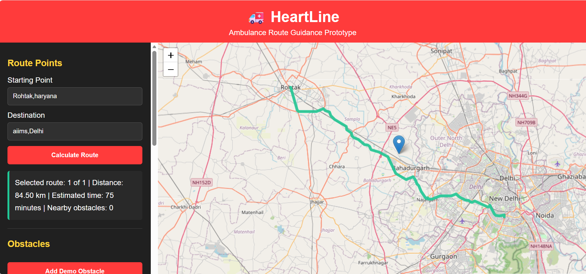
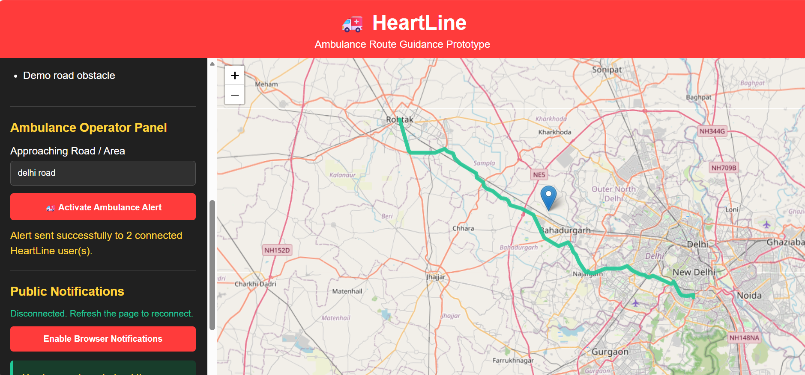

# HeartLine — Smart Ambulance Routing & Traffic Alert System

## About
HeartLine is a web-based prototype designed to support ambulance route guidance and browser-based alerts for connected users.
## Project Presentation

[View HeartLine Presentation (PDF)](HeartLine_Presentation.pdf.pdf)
## Features
- Calculate routes between an origin and destination.
- Display routes on an interactive map.
- Show route distance and estimated travel time.
- Add demo road obstacles.
- Send ambulance alerts to connected HeartLine users.
- Support browser notifications when permission is granted.

## Technology Stack
- **Frontend:** HTML, CSS, JavaScript (if used in the project)
- **Backend:** Python
- **Mapping:** Leaflet, OpenStreetMap, Nominatim and OSRM (as applicable to the code)
- **Notifications:** WebSockets and Browser Notifications API (if implemented)

## Current Limitations
This is a prototype. Demo obstacles and simulated alerts should not be interpreted as live traffic or production ambulance dispatch integration.

## Setup
Setup instructions and dependencies will be documented after verifying the backend imports and configuration.

## Team
**5ive Minds — IGDTUW**

## HeartLine Demo Video

[▶ Watch our HeartLine Prototype Demo](https://drive.google.com/file/d/16H6wowPwdFX23E0EUilDycJc4zJxM3Dn/view?usp=drivesdk)

